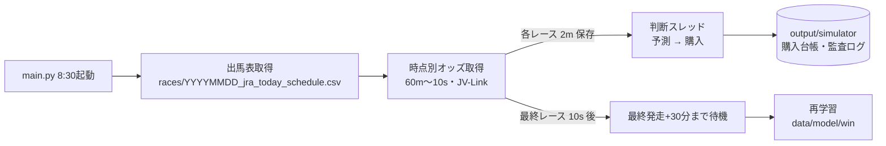

# KeibaAI

JRA のレース当日に、次の4つを1本のプログラム（`main.py`）で行います。

1. 当日の発走時刻を取得する
2. 発走時刻に合わせて JRA-VAN（JV-Link）から単勝・複勝・枠連のオッズと票数を取得する
3. 各レースの発走**2分前**のオッズで勝率・複勝率を予測し、購入ルールに従って即PATで馬券を買う
4. 全レース終了後にモデルを再学習する

採用している戦略は「穴馬戦略」（締切直前の資金流入 × 高オッズ）で、**単勝モデル**と
**複勝モデル**の2つがあります。`main.py` は既定で両方を動かし、`--win` / `--place` で片方だけにできます。

| モデル | 検証レポート |
| --- | --- |
| 単勝 | `docs/report/anaba_strategy_report/anaba_strategy_report.md` |
| 複勝 | `docs/report/anaba_strategy_place_report/anaba_place_band_report.md`（購入帯・最終モデル）/ `anaba_place_strategy_report.md`（単勝との比較） |

> **IMPORTANT: 総投票額の下限は当日データ用に 0.4億円へ変更しています**
> 学習データ（JV-Link 履歴 `0B41`）と当日データ（速報 `0B31`）で `hyosu_total` の
> スケールが **9〜13倍**違います（競馬場を揃えても同じ）。そのため履歴で検証した
> 5億円を当日データに当てると**1レースも通りません**。
> 現在は当日スケールで「日内上位50%」に相当する **0.4億円**を既定にしています。
> **ただしこの値の根拠は1開催日22レースのみで信頼性は低く、開催を重ねたら
> 測り直す必要があります。** 本筋は当日取得を履歴と同じ `0B41` に揃えることです。
> 詳細は `docs/report/pool_by_race_number_report.md` §6 と §9 を参照してください。

> **IMPORTANT: この条件の組み合わせは未検証です**
> レポートの検証値（回収率136.98% / 95%CI [109.3, 161.4]）は
> EV≥1.20・1レース最大3点・**1分前**判断・fractional Kelly の構成です。
> 本実装は EV≥1.05・1レース1点・**2分前**判断・Flat100円に総投票額フィルタを
> 加えた別の構成で、この組み合わせ自体の成績は検証されていません。
> 的中率5%・平均40倍の高分散戦略です。実購入（live）の前に必ず paper / dry-run で
> 動作を確認してください。

---

## 目次

1. [1日の流れ](#1-1日の流れ)
2. [セットアップ](#2-セットアップ)
3. [日次実行（main.py）](#3-日次実行mainpy)
4. [出力ファイル](#4-出力ファイル)
5. [個別実行](#5-個別実行)
6. [コード構成](#6-コード構成)
7. [予測モデルと購入ルール](#7-予測モデルと購入ルール)
8. [購入の安全装置](#8-購入の安全装置)
9. [制約・注意点](#9-制約注意点)
10. [トラブルシューティング](#10-トラブルシューティング)
11. [テスト](#11-テスト)

---

## 1. 1日の流れ

最初のレースが 10:05、最終レースが 16:25 の日の例です。

| 時刻 | 処理 | 担当モジュール |
| --- | --- | --- |
| 08:30 | `main.py` 起動（タスクスケジューラ） | `main.py` |
| 08:30 | JRA 出馬表から全競馬場・全レースの発走時刻を取得し CSV 保存 | `src/scraping/_jra_today_schedule.py` |
| 09:05〜 | 各レースの **60m・30m・10m・5m・4m・3m・2m・1m・10s 前**に JV-Link からオッズ・票数を取得し、レース別 CSV に追記 | `src/scraping/realtime_odds.py` |
| 各レースの 2分前 | 2m の保存が終わったレースを判断スレッドへ渡し、60m〜5m と 2m から22列の特徴量を作成 → 勝率予測 → 購入条件の判定 → Flat100円 → 安全審査 → 即PATで購入 | `src/pipeline/daily.py` → `src/simulator/` → `src/buying/` |
| 16:24:50 | 最終レースの 10s 前の取得で、オッズ取得が終了 | |
| 16:55 | 最終レース発走 + 30分で再学習し、モデルを更新（次の開催日から使われる） | `src/simulator/retrain.py` |



- オッズ取得（JV-Link）はメインスレッド、予測・購入は別スレッドで動きます。購入のブラウザ操作に時間がかかっても、他レースのオッズ取得は止まりません。
- 2分前のオッズは「発走2分前の時刻までに JRA-VAN が発表した最新値」です。保存は2分前の約2秒後に完了し、購入の送信期限（既定: 発走**90秒**前）までの約30秒で予測と購入を行います。
- 送信期限は判断時点（120秒前）より後ろでなければなりません。`BUYING_SUBMIT_DEADLINE_LEAD_SECONDS` を 120 以上にすると判断と同時に期限切れになり全ての購入が見送られるため、起動時に設定エラーで停止します。
- 2m の取得に失敗したレースは 3m → 4m の順で代用し、実際に使った時点を CSV の `decision_snapshot_used` 列に残します。

---

## 2. セットアップ

### 2.1 動作環境

- Windows（JV-Link は Windows 専用の COM コンポーネント）
- JRA-VAN データラボ会員登録と JV-Link のインストール・利用設定
- Python 3.11〜3.13
- 即PAT の会員登録（購入する場合）

### 2.2 インストール

```powershell
cd C:\Users\<ユーザー>\デスクトップ\src\KeibaAI_Main
python -m venv .venv
.venv\Scripts\python.exe -m pip install -r requirement.txt
.venv\Scripts\python.exe -m playwright install chromium
```

### 2.3 設定ファイル

| ファイル | 内容 | 用意の仕方 |
| --- | --- | --- |
| `config/config.yaml` | データ・モデルの場所、賭け金計算、再学習期間 | 同梱。必要に応じて編集 |
| `config/features.json` | 特徴量定義（本システムでは空で可） | 同梱 |
| `src/buying/.env` | 即PAT の認証情報、購入モード、金額上限、締切 | `env.example` をコピーして編集。**リポジトリに登録しない** |

`config/config.yaml` の主な項目:

```yaml
pipeline:
  model_filename: win/win_anaba.txt
  retrain_start_period: '202301'   # 1m が使えるのは2023年以降（§9 参照）
  retrain_delay_minutes: 30        # 最終レース発走から再学習を始めるまでの分数

# 購入条件。すべて src/simulator/strategy.py の既定値を上書きできる。
strategy:
  min_ev: 1.05               # EV = 予測確率 × 2mオッズ の下限
  odds_min: 10.0             # 2mオッズの下限
  odds_max: 150.0            # 2mオッズの上限
  max_drift: -0.05           # log(2mオッズ / 5mオッズ) の上限（負=オッズが下がった）
  min_pool_yen: 40000000     # 2m時点の総投票額の下限（当日スケールで0.4億円）
  min_pool_pctile: null      # 日内分位点で絞る場合に設定（レース単位運用では使えない）
  max_bets_per_race: 1       # 期待値最大の1頭のみ
  stake_yen: 100             # Flat ベット（1点100円）
```

`src/buying/.env` の主な項目（詳細は `env.example` と `src/buying/README.md`）:

| キー | 意味 | 初期値 |
| --- | --- | --- |
| `JRA_INET_ID` / `JRA_KANYUSHA_NO` / `JRA_PIN` / `JRA_PARS_NO` | 即PAT の認証情報 | 要設定 |
| `BUYING_MODE` | `paper`（画面操作なし）/ `dry-run`（確認画面まで操作して取消）/ `live`（実購入） | `dry-run` |
| `BUYING_KILL_SWITCH` | `true` の間は一切購入しない | `true` |
| `BUYING_MAX_BET_YEN` / `_RACE_YEN` / `_DAY_YEN` / `_SESSION_YEN` | 1点・1レース・1日・1回の購入処理あたりの上限（円）。超えるとレースごと見送り | すべて 100 |
| `BUYING_MAX_BETS_PER_RACE` | 1レースの最大点数。超えるとレースごと見送り | 1 |
| `BUYING_SUBMIT_DEADLINE_LEAD_SECONDS` | 発走何秒前を送信期限とするか。判断時点（120秒前）より小さい値が必須 | 90 |
| `BUYING_MAX_ODDS_AGE_SECONDS` | 判断に使うオッズの鮮度上限（秒） | 180 |

### 2.4 必要なデータ

| データ | 場所 | 用途 | 作り方 |
| --- | --- | --- | --- |
| 学習済みモデル | `data/model/win/win_anaba.txt`、`_calibrator.pkl`、`_simulator.json` | 当日の予測 | `python main.py --retrain-only`（下の2つが必要） |
| 月別締切前オッズ | `data/processed/odds_series/YYYYMM_odds_series_tansho.csv` | 再学習の特徴量 | **本リポジトリ外**（`odds_series_scraper`） |
| 着順 | `data/processed/horses/*_horses.csv` | 再学習のラベル | **本リポジトリ外** |

月別締切前オッズには `race_id, date, umaban` と、`60m / 30m / 10m / 5m / 1m` 各時点の
`odds_win_{時点}` / `hyosu_total_{時点}` の列が必要です。着順には
`race_id, horse_number, finish_position` の列が必要です。

モデルが無い日は、`main.py` は予測・購入を行わずに、オッズ取得と再学習だけを行います（ログに ERROR が出ます）。

### 2.5 タスクスケジューラへの登録

開催日の 8:30 に `scripts/run_daily.bat` を起動するよう登録します。

```powershell
schtasks /Create /TN "KeibaAI Daily" /SC WEEKLY /D SAT,SUN /ST 08:30 `
  /TR "\"C:\Users\<ユーザー>\デスクトップ\src\KeibaAI_Main\scripts\run_daily.bat\""
```

- 祝日開催（月曜など）は別途トリガーを追加してください。開催の無い日に起動すると、出馬表が取れず終了コード 1 で終了します。
- JV-Link の COM やブラウザ操作が必要なため、最初は「ユーザーがログオンしている場合のみ実行」で登録してください。
- PC がスリープしないよう電源設定を確認してください。
- 引数を付ける場合: `/TR "\"...\run_daily.bat\" --paper"`

---

## 3. 日次実行（main.py）

```powershell
.venv\Scripts\python.exe main.py            # 単勝・複勝の両方。.env の BUYING_MODE に従って購入
.venv\Scripts\python.exe main.py --win      # 単勝モデルだけ
.venv\Scripts\python.exe main.py --place    # 複勝モデルだけ
.venv\Scripts\python.exe main.py --paper    # ブラウザを開かずに購入判定と台帳記録だけ行う
.venv\Scripts\python.exe main.py --no-buy   # 予測 CSV の出力まで（購入処理を呼ばない）
.venv\Scripts\python.exe main.py --live     # BUYING_MODE=live のときの実購入（明示が必須）
.venv\Scripts\python.exe main.py --retrain-only   # 再学習だけすぐに実行
```

| オプション | 意味 |
| --- | --- |
| `--win` / `--place` | 実行するモデル。どちらも付けなければ両方。予測・購入・再学習のすべてに効く |
| `--place-min-ev X` | 複勝の EV しきい値（既定: `config.yaml` の `place_strategy.min_ev`。通常 1.05） |
| `--place-model-dir DIR` | `data/model` 配下の複勝モデルフォルダ（既定: `place`） |
| `--no-buy` / `--paper` / `--live` | 購入の扱い（同時指定不可）。指定なしは `.env` の `BUYING_MODE`。`BUYING_MODE=live` なのに `--live` が無い場合は起動時に停止する |
| `--no-retrain` / `--retrain-only` | 再学習をしない / 再学習だけ行う |
| `--retrain-start-period YYYYMM` | 再学習の開始年月（既定: `config.yaml` の値） |
| `--retrain-delay-minutes N` | 最終レース発走から再学習までの分数（既定: 30） |
| `--min-ev X` | EV しきい値（既定: `config.yaml` の `strategy.min_ev`。通常 1.05） |
| `--model-filename PATH` | `data/model` 配下のモデルファイル名 |
| `--include-past` | 起動が遅れて過ぎた取得時点を、JV-Link の時系列オッズから復元する |
| `--headed` | 出馬表取得用ブラウザを表示する |
| `--config` / `--env` | 設定ファイルの場所 |

**停止**: `Ctrl+C` でオッズ取得を止めると、処理中・判断待ちのレースの予測と購入を終えてから終了します。再学習は行いません。もう一度 `Ctrl+C` を押すと、購入の途中でも強制終了します。その場合は `python -m src.buying.cli reconcile` で成立状況を確認してください。

**終了コード**:

| コード | 意味 |
| --- | --- |
| 0 | 正常終了 |
| 1 | 起動時の設定エラー、出馬表の取得失敗、予測・購入・再学習のいずれかでエラー（日次レポートの `errors` を確認） |
| 2 | 成立不明の購入がある（`python -m src.buying.cli reconcile` で即PATと照合） |
| 130 | `Ctrl+C` で中断 |

---

## 4. 出力ファイル

| パス | 内容 | 作成元 |
| --- | --- | --- |
| `data/processed/schedules/YYYYMMDD_jra_today_schedule.csv` | **当日のレース予定**（race_id・rt_key・競馬場・レース番号・発走時刻） | 出馬表取得 |
| `data/processed/realtime_odds/YYYYMMDD/{race_id}_tansho_realtimeodds.csv` | 単勝オッズ・票数（60m〜10s の全時点。`snapshot_label` 列で区別） | オッズ取得 |
| `data/processed/realtime_odds/YYYYMMDD/{race_id}_fukusho_realtimeodds.csv` | 複勝 | オッズ取得 |
| `data/processed/realtime_odds/YYYYMMDD/{race_id}_wakuren_realtimeodds.csv` | 枠連 | オッズ取得 |
| `data/processed/realtime_odds/YYYYMMDD/YYYYMMDD_scheduler_events.csv` | 各取得時点の**実行記録**（取得時刻・鮮度・状態）。購入時の安全審査にも使う | オッズ取得 |
| `output/simulator/YYYYMMDD_all.csv` | 全馬の予測（予測確率・2mオッズ・ドリフト・総投票額・EV・賭け金・**どのフィルタで外れたか**） | 予測 |
| `output/simulator/YYYYMMDD_bets.csv` | 推奨買い目だけ | 予測 |
| `output/simulator/YYYYMMDD_place_all.csv` / `_place_bets.csv` | 複勝の全馬予測（予測複勝率・複勝オッズ min/max・EV・見送り理由）/ 推奨のみ | 予測（複勝） |
| `data/model/place/place_model_seed{0..4}.txt` ほか | 複勝モデル（5シード）・校正器（`.npz`）・メタ（`place_model_meta.json`） | 再学習（複勝） |
| `data/processed/buying/buying_ledger.sqlite3` | 購入台帳（同じ買い目の二重購入を防ぐ） | 購入 |
| `data/processed/buying/logs/YYYYMMDD_buying.jsonl` | 購入の監査ログ（安全審査で見送った理由を含む。認証情報はマスク） | 購入 |
| `data/model/win/win_anaba.txt` ほか2ファイル | 学習済みモデル・確率校正器・運用パラメータ | 再学習 |
| `output/pipeline/YYYYMMDD_pipeline_report.json` | 日次レポート（レース数、レースごとの予測・購入結果、再学習結果、エラー） | main.py |
| `logs/pipeline/YYYYMMDD_pipeline.log` | 日次の実行ログ（画面に出る内容と同じ） | main.py |

> レース予定は `YYYYMMDD_jra_today_schedule.csv` です。`YYYYMMDD_scheduler_events.csv` はレース予定ではなく、オッズ取得の実行記録です。

オッズ CSV の主な列: `race_id`, `umaban`（枠連は `kumiban`）, `snapshot_label`, `target_datetime`（基準時刻）, `happyo_datetime`（JRA-VAN の発表時刻）, `odds_win`（単勝）/ `odds_place_min`・`odds_place_max`（複勝）/ `odds_wakuren`（枠連）, `hyosu_total`（その券種のレース全体の票数合計・100円単位）, `ninkijun`, `source_age_seconds`。JV-Link の O1 レコードには馬ごとの票数が無いため、馬ごとの投票額は予測時に `0.8 × hyosu_total ÷ odds_win` で逆算しています。列の詳細は `docs/manual/scraper_manual.md` を参照してください。

---

## 5. 個別実行

`main.py` を使わずに、各段階を単独で実行できます。

```powershell
# オッズ取得だけ（当日、最終レースまで動き続ける）
.venv\Scripts\python.exe -m src.scraping.realtime_odds

# 取得済みオッズで当日の全レースを予測（10m・5m が揃ったレースが対象）
.venv\Scripts\python.exe -m src.simulator.predict_today --date 2026-09-20

# 再学習
.venv\Scripts\python.exe -m src.simulator.retrain --start-period 202401 --end-period 202609

# 複勝: 当日予測 / 再学習
.venv\Scripts\python.exe -m src.simulator.predict_place --date 2026-09-20
.venv\Scripts\python.exe -m src.simulator.place_model --start-period 202401 --end-period 202607

# 複勝の推奨 CSV で購入計画を検証
.venv\Scripts\python.exe -m src.buying.cli paper --date 2026-09-20 --bet-type place --bets-csv output\simulator\20260920_place_bets.csv

# 購入システムの診断・購入計画の検証・成立不明の確認
.venv\Scripts\python.exe -m src.buying.cli doctor
.venv\Scripts\python.exe -m src.buying.cli paper --date 2026-09-20 --bets-csv output\simulator\20260920_bets.csv
.venv\Scripts\python.exe -m src.buying.cli reconcile
```

---

## 6. コード構成

```text
KeibaAI_Main/
├── main.py                      日次実行の入口（引数解析・ログ設定）
├── scripts/run_daily.bat        タスクスケジューラ用の起動バッチ
├── config/
│   ├── config.yaml              データ・モデル・賭け金・日次実行の設定
│   └── features.json            特徴量定義（本システムでは空）
├── env.example                  src/buying/.env のひな型
├── requirement.txt              依存パッケージ
├── src/
│   ├── pipeline/                ── 日次パイプライン
│   │   └── daily.py             [1]〜[4] の実行、判断スレッド、日次レポート
│   ├── scraping/                ── データ取得
│   │   ├── realtime_odds.py     発走時刻に合わせた時点別オッズ取得スケジューラ（公開CLI）
│   │   ├── _jra_today_schedule.py  JRA 出馬表（Playwright）から発走時刻・rt_key を取得
│   │   ├── _jvlink_o1.py        JV-Link 速報オッズ O1 レコードの取得・解析
│   │   └── _netkeiba_today_fetcher.py  未使用（参照先モジュールが無く import できない）
│   ├── simulator/               ── 予測と再学習
│   │   ├── features.py          22列の特徴量の定義（学習=1m / 当日=2m を共通化）
│   │   ├── strategy.py          購入条件（EV・オッズ帯・ドリフト・総投票額）と Flat ベット
│   │   ├── realtime_loader.py   当日のレース別オッズ CSV から 60m〜5m・2m を読む
│   │   ├── predict_today.py     予測 → 購入条件の判定 → 推奨 CSV（見送り理由つき）
│   │   ├── retrain.py           過去データで LightGBM を再学習し、確率を校正して保存
│   │   ├── place_model.py       複勝モデル（5シード LightGBM + isotonic）の学習・保存・予測
│   │   ├── place_strategy.py    複勝の購入条件（複勝EV・複勝オッズ帯・ドリフト・1レース3点）
│   │   ├── predict_place.py     複勝の当日予測 → 推奨 CSV
│   │   ├── artifacts.py         モデルと運用パラメータ（特徴量列・学習時点）の保存・検証
│   │   ├── odds_series_loader.py  学習用の月別締切前オッズの読込・票数逆算
│   │   └── dataset.py           着順（学習ラベル）の読込
│   ├── buying/                  ── 即PAT 自動購入（詳細は src/buying/README.md）
│   │   ├── strategy.py          予測結果を購入指示（BetIntent）へ変換
│   │   ├── risk.py              購入前の安全審査（締切・金額上限・オッズ鮮度・2m 証跡）
│   │   ├── service.py           安全審査 → 台帳予約 → 画面操作 → 結果記録
│   │   ├── browser/             Playwright による即PAT 画面操作
│   │   ├── ledger.py            SQLite 購入台帳（冪等性・二重購入防止）
│   │   ├── snapshot_reader.py   レース予定と取得記録を購入用の型に変換
│   │   ├── config.py            .env の読込と検証
│   │   ├── audit.py / clock.py / domain.py / process_lock.py  監査ログ・時刻・型・多重起動防止
│   │   └── cli.py               購入システム単体の CLI（doctor / paper / reconcile 等）
│   ├── models/                  ── LightGBM 学習・予測・評価の共通ライブラリ
│   │   ├── model_creator.py     学習・校正・予測・保存の窓口（simulator から利用）
│   │   ├── trainer.py           LightGBM 学習・確率校正・保存の実装
│   │   ├── evaluation.py        評価指標と Kelly 賭け金計算
│   │   └── その他               本体パイプライン用（スタッキング、馬連・三連複、CV 等）。日次実行では import のみ
│   └── cli_common.py            設定ファイル読込などの共通処理
├── data/
│   ├── processed/schedules/     当日のレース予定
│   ├── processed/realtime_odds/ 当日オッズ（日付フォルダ）
│   ├── processed/odds_series/   学習用の月別締切前オッズ（外部で用意）
│   ├── processed/horses/        着順（外部で用意）
│   ├── processed/buying/        購入台帳・監査ログ
│   └── model/win/               学習済みモデル
├── output/                      予測結果・日次レポート
├── logs/                        実行ログ
├── docs/                        仕様書・実装レポート・取得マニュアル
└── tests/                       単体テスト
```

---

## 7. 予測モデルと購入ルール

戦略の核心は1行で書けます。

> **締切直前に、10〜150倍で、直前の数分間にオッズが下がった馬を買う。**

| 項目 | 内容 |
| --- | --- |
| 特徴量（22列） | すべて市場スナップショット由来。中核は `inc_share_5_late`（5m→2m に入った新規資金のうちその馬が占める割合）、`log_odds_late`、`mkt_late`、`mkt_ratio_to_fav` の4列で、importance の約9割を占める |
| モデル | LightGBM 二値分類（1着か否か）＋ isotonic 確率校正（`num_leaves=31`, `max_depth=5`, `lambda_l2=5.0`） |
| 学習 | 2023年1月以降の `60m/30m/10m/5m/1m`。末尾6ヶ月を holdout にして early stopping と確率校正に使う |
| 買う馬（全条件を満たすこと） | ① `EV = 予測確率 × 2mオッズ ≥ 1.05`<br>② `2mオッズ` が 10倍以上 150倍以下<br>③ `log(2mオッズ / 5mオッズ) ≤ -0.05`（オッズが約5%以上下がった）<br>④ レースの2m時点総投票額が **0.4億円以上**（当日データのスケール。上記 IMPORTANT 参照） |
| 1レースの点数 | 条件を満たす馬が複数いる場合は**期待値が最も高い1頭のみ**。複数レースが条件を満たせば各レースで1頭ずつ買う |
| 賭け金 | **Flat ベット（1点100円）**。Kelly は使わない |
| 実際の上限 | `.env` の `BUYING_MAX_*` を超える買い目を含むレースは、**減額せずにレースごと見送る** |

購入条件は `config/config.yaml` の `strategy` セクションで変更できます（既定値は
`src/simulator/strategy.py`）。モデルの再学習とは独立に変えられます。

- 確率は isotonic で校正済みで、予測値をそのまま勝率として読めます（実測で予測0.08%の馬は実際に0.07%、予測32.3%の馬は31.9%勝ちました）。`EV = 確率 × オッズ` はこの校正を前提にしており、校正器が無いと予測は停止します。
- 特徴量の定義を変えると、保存済みモデルとの不一致を検出して予測を停止します。その場合は再学習してください。
- 全馬の予測 CSV には、各馬が**どのフィルタで外れたか**が `skip_reason` 列に残ります（複数該当時は `pool_below_min|ev_below_threshold` のように連結）。

### 7.0 複勝モデル

> **発走直前に、複勝オッズ（min側）6〜20倍で、期待値1.05以上、直前に単勝オッズが下がった馬を複勝で買う。**

| 項目 | 内容 |
| --- | --- |
| 特徴量 | 単勝モデルと同じ22列（市場スナップショットのみ） |
| ラベル | 複勝圏に入ったか。**7頭以下は2着まで・8頭以上は3着まで**（着順と出走頭数から作る。払戻データが無いため） |
| モデル | LightGBM 二値分類を**5シード**独立に学習し、各シードを isotonic で校正して平均 |
| 学習 | 既定 2024年1月以降（`pipeline.place_retrain_start_period`）。期間末尾20%を holdout にして early stopping と校正に使う |
| 買う馬（全条件） | ① `複勝EV = 予測複勝率 × 複勝オッズ(min側) ≥ 1.05`<br>② 複勝オッズ(min側)が **6倍以上20倍以下**<br>③ `log(単勝2m / 単勝5m) ≤ -0.05` |
| 1レースの点数 | 期待値の高い順に**最大3点** |
| 賭け金 | Flat 100円 |

- 期待値は必ず複勝オッズの **min 側**で計算します（締切前は配当の幅しか確定しないため。保守側）。
- 複勝オッズは、単勝の判断に使った時点と同じ時点（通常 2m）の値を使います。複勝オッズが無い馬は `place_odds_missing` で見送ります。
- 購入条件は `config.yaml` の `place_strategy` で変更できます。
- 単勝と複勝の購入は1回のログインでまとめて行い、券種ごとに確認画面まで進めます。`BUYING_MAX_RACE_YEN` は同じレースの単勝・複勝の**合計**で判定します。
- 複勝を買うには `.env` で `BUYING_ALLOWED_BET_TYPES` に `place` を含め、`BUYING_MAX_BETS_PER_RACE` を **3 以上**にしてください。1 のままだと複勝の推奨が2点以上のレースは減額せずレースごと見送られます（起動時に WARNING が出ます）。
- **レポートの成績（回収率 140.43% CV / 144.54% 真のOOS、95%CI 下側 107〜113%）は1分前判断の数字です。** 本実装は単勝と同じ2分前判断で、この構成での成績は未検証です。

### 7.1 レポートの検証構成との差分

| 項目 | レポートの検証 | 本実装 |
| --- | --- | --- |
| 判断時点 | 1分前 | **2分前** |
| EV しきい値 | 1.20 | **1.05** |
| 1レースの点数 | 最大3点 | **1点** |
| 賭け金 | fractional Kelly（係数0.10） | **Flat 100円** |
| 総投票額フィルタ | 無し（§5 の知見として提示のみ） | **5億円以上** |
| 特徴量 | 29列 | **22列**（データが無い/当日取れない7列を除外） |

レポートの回収率 136.98%（95%CI [109.3, 161.4]）は左列の構成の数字です。
**本実装の構成での成績は検証されていません。**

---

## 8. 購入の安全装置

`main.py` の購入はすべて `src/buying` の安全装置を通ります。

- **モード**: `paper` → `dry-run` → `live` の順に確認してください。live は `BUYING_MODE=live` と `--live` の両方が必要です。
- **kill switch**: `BUYING_KILL_SWITCH=true` の間は購入せず、判定と記録だけ行います（初期値 true）。
- **安全審査（RiskGate）**: 送信期限（発走90秒前）より前であること、金額・点数が上限以内であること、2分前オッズの証跡（`snapshot_label=2m`、基準時刻が発走2分前、状態 `saved`、鮮度180秒以内）を確認し、1つでも満たさないレースは購入しません。上限を超えた場合も減額はせず、レースごと見送ります。
- **確認画面の照合**: 即PAT の確認画面に表示された合計金額が購入指示と一致しない場合は送信しません。
- **二重購入防止**: 購入台帳の一意キーで、同じレース・同じ買い目を二度送信しません。
- **成立不明の扱い**: 送信後に結果が確認できない場合は「成立不明」として記録し、自動で再送しません（終了コード 2）。
- **多重起動防止**: 同じアカウントの購入処理は1プロセスだけ実行できます。

---

## 9. 制約・注意点

- **再学習に当日の結果は自動では入りません。** 学習データ（`data/processed/odds_series`、`data/processed/horses`）を更新する処理は本リポジトリに無いため、17時前後の自動再学習は、その時点で置かれている学習データで学習し直します。当日分を学習に含めるには、学習データを更新してから `python main.py --retrain-only` を実行してください。学習データの最終日が当日より前の場合は、その旨がログに WARNING で出ます。
- **総投票額のスケールが学習と当日で違う（最重要）**: 学習データ（JV-Link 履歴 `0B41`）と当日データ（速報 `0B31`）で `hyosu_total` が **9〜13倍**違います（当日中央値0.40億円 / 履歴1m中央値5.73億円。**競馬場を揃えても倍率は変わらない**ので開催の質ではなくデータ区分の違いです）。オッズ自体は両方とも控除率21%前後で整合しており壊れていません。**総票数の絶対値だけ**がずれています。
  - 現在の既定は当日スケールの **0.4億円**（日内上位50%相当）です。**根拠は1開催日22レースのみで信頼性は低く**、開催を重ねたら必ず測り直してください。
  - 倍率は時点により一定でない（60m:8.3倍 / 1m:11.9倍）ため、**単純な定数倍での換算もできません**。
  - **本筋の対処は当日取得を履歴と同じ `0B41` に揃えること**です。これにより §5 の検証知見（7億円で回収率200.7%など）をそのまま使えます。
  - 購入が0点続く場合は、まず `strategy.min_pool_yen` を疑ってください（全レースが落ちた場合は ERROR ログで明示します）。
  - 分位点モード（`strategy.min_pool_pctile`）も実装していますが、レース単位で判断する `main.py` の経路では「渡されたレースの中での順位」になり**フィルタが無効化される**ため既定では無効です。日次バッチで全レースまとめて判定する場合にのみ使えます。
- **学習は1分前・当日判断は2分前というずれ**: 過去データ `data/processed/odds_series` に 2m 列が無く、`3m` 列は全月・全行で `5m` と完全に同一（JV-Link 履歴が実質 5m → 1m しか返していない）ため、2m で学習する手段がありません。よってモデルは 1m で学習し、当日は 2m で判断します。区間が4分と3分で違うため、2m のドリフトは 1m よりやや小さく出ます（採用が保守的になる側のずれ）。実行時に WARNING で明示されます。
- **学習期間は2023年1月以降に限る**: `1m` が実質的に更新されるのは2023年以降です（2016〜2021年は98%のレースで `5m` と `1m` の総票数が同一）。それより前を混ぜると「年代の代理変数」になるため、既定の開始年月は `202301` で、それより前を指定すると WARNING が出ます。
- **本実装の条件の組み合わせは未検証**です（§7.1 と冒頭の注意を参照）。
- **高分散**: 的中率5%・平均40倍の戦略です。レポートでは122点の連続不的中と最大18.7万円のドローダウン（1点1,000円時）が観測され、最初の9ヶ月はマイナス圏でした。
- **当日取得できない特徴量は使っていません**: 馬体重・斤量・性齢はこのリポジトリの当日データ（出馬表 CSV）に無く、出馬表パーサも存在しないため、特徴量から外しています。距離・馬場は学習データにもありません。出馬表から取得できるようになれば `FEATURE_COLS` に戻して再学習する価値があります。
- **PC の時計**: 取得・購入の判定は PC の時刻（日本時間）で行います。Windows の時刻同期を有効にしてください。
- **実行中に CSV を Excel で開かない**: Excel が開いたファイルは書き込めなくなり、取得に失敗します。
- **起動の遅れ**: 起動時点で過ぎた取得時点は既定でスキップします（`skipped_at_startup` として記録）。`--include-past` で復元できますが、時系列オッズは5〜10分程度の粒度なので、5分前の厳密な値にはなりません。
- **ブラウザ操作**: 即PAT の画面変更、メンテナンス、追加認証があると購入は失敗します（見送りとして記録されます）。
- `src/scraping/_netkeiba_today_fetcher.py` は参照先のモジュールが無く、import できません（どこからも使われていません）。

---

## 10. トラブルシューティング

| 症状 | 確認すること |
| --- | --- |
| `起動できませんでした: 認証情報が未設定です` | `src/buying/.env` の作成。購入しない場合は `--no-buy` か `--paper` |
| `BUYING_MODE=live の実購入には --live の指定が必要です` | 意図した live なら `--live` を付ける |
| `モデルが使えないため…` | `data/model/win/` のモデル3ファイル。特徴量が変わった場合は `--retrain-only` で作り直す |
| `本日の開催が無いか、出馬表を取得できませんでした` | 開催日か、JRA サイトに接続できるか。`--headed` で画面を確認 |
| 予測が `10m と 5m のオッズが1行も対応しませんでした` | `realtime_odds/YYYYMMDD/YYYYMMDD_scheduler_events.csv` の該当レースの `status`（`jvlink_unavailable` なら JV-Link の状態） |
| 購入されない | `data/processed/buying/logs/YYYYMMDD_buying.jsonl` の `race_rejected` の `reasons`（`kill_switch`、`submit_deadline_expired`、`odds_stale`、`max_*` 等） |
| 終了コード 2 | `python -m src.buying.cli reconcile` を実行し、即PAT の投票内容照会と照合 |
| 再学習の失敗 | `data/processed/odds_series` と `data/processed/horses` の有無・期間、`config.yaml` の `retrain_start_period`。失敗しても既存モデルは残る |

---

## 11. テスト

```powershell
.venv\Scripts\python.exe -m unittest discover -s tests
```

JV-Link・即PAT・JRA サイトにはアクセスせず、モックと一時フォルダで動作を確認します。
